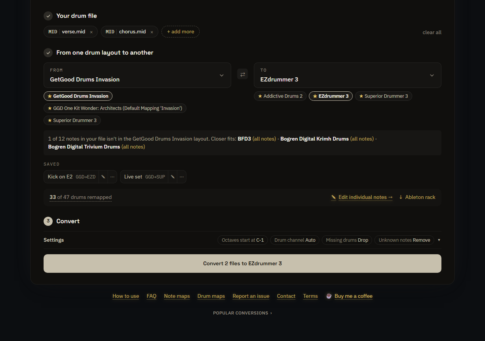

# Drumverter

Convert drum MIDI between sample-engine note layouts — GetGood Drums, EZdrummer,
Superior Drummer 3, Addictive Drums 2, General MIDI, Guitar Pro and 80+ others.

**Use it at [drumverter.com](https://drumverter.com).** It runs in your browser; files
are never uploaded.



- Three steps: add your `.mid` files (or try a sample groove), pick the FROM and TO
  engines, convert. Star an engine to keep it as a one-press favourite under its card.
- Every note goes through a shared drum vocabulary, so any engine converts to any other.
- A drum the target lacks is played on the nearest one it has (a China on a crash), or
  left out if you choose **Drop**; a rimshot or flam still falls back to a plain hit on
  the same drum.
- A note the source layout does not know is removed, or kept as it is if you choose
  **Keep as they are** (for files partly written for another kit).
- Once both engines are picked, a summary row says how many drums move; hover the dotted
  count to see what happens to every drum, **Edit individual notes →** to change any of
  them, or **↓ Ableton rack** to play live instead of converting (below). Each conversion
  comes with a report of approximated, dropped and unrecognized notes, with links to fix
  them in the note editor.
- Edits can be saved as presets, shown as chips under the engines: a click loads one, and
  its ⋯ menu renames, duplicates, exports (`.json`), downloads its Ableton rack or deletes
  it. Presets stay in your browser; drop an exported one on the page to use it elsewhere.
- **Ableton racks**: a MIDI Effect Rack (`.adg`) for Live 11 and 12 that you put in front of
  the target plugin, so the source's MIDI plays right with no file to convert. It comes
  from the summary row (with your note edits and settings), from a saved preset's menu, or
  ready-made with the defaults on each pair's page.
- **Drum maps**: every engine's note names for Reaper, Cubase, Studio One and Ableton Live,
  on [drumverter.com/drum-maps/](https://drumverter.com/drum-maps/) and each engine's page.
- Batch conversion, drum-channel selection, 11 languages, and a command-line tool for
  offline use.

## Translations

Drumverter is translated on [Hosted Weblate](https://hosted.weblate.org/projects/drumverter/).
[TRANSLATING.md](TRANSLATING.md) says how, for translators and for developers.

## Workspace

| Path | What it is |
|---|---|
| `midiremap-core` | Pure Rust engine: canonical drums, fallback chains, MIDI rewrite, loss report, Ableton racks and DAW drum maps |
| `midiremap-cli` | Offline `convert` / `list` command |
| `midiremap-wasm` | Browser bindings used by the app |
| `midiremap-site` | Static pages: per-engine note maps, pair tables, drum-map files and pair racks, FAQ and guide |
| `midiremap-testkit` | Test helpers that build and read small MIDI files |
| `app/` | Vite + React + TypeScript converter UI |
| `engines/*.toml` | One note map per engine, embedded at build time |
| `locales/` | The locale list, and per language the Fluent messages the app shows (`app.ftl`, read by the site too), the ones only the site reads (`site.ftl`) and a documents file |
| `content/` | The site structure and the tip links, shared by the app and the site |
| `TRANSLATING.md` | How the `locales/` messages are translated on Hosted Weblate, and the rules for adding one |

[ARCHITECTURE.md](ARCHITECTURE.md) explains the design; [app/README.md](app/README.md)
covers the UI.

## Build and test

Requirements: rustup (it installs the Rust version pinned in `rust-toolchain.toml`,
wasm target included), the nightly named in `nightly-toolchain` for `rustfmt`, Node 22.18+
(`.nvmrc`), and `wasm-bindgen-cli` at the version in `Cargo.lock`.

```bash
cargo +"$(cat nightly-toolchain)" fmt --all
cargo clippy --workspace --all-targets -- -D warnings
cargo test --workspace           # the gate runs both per configuration: see xtask/src/step.rs

cd app
npm ci
npm run dev          # builds the wasm module, then starts Vite
npm run lint
npm test
npm run build:site   # app + static pages into app/dist
npx playwright install chromium   # once
npm run e2e          # browser tests of every user story against app/dist, desktop and phone
npm run size         # size budgets for app/dist/assets
npm run screenshot   # rewrites docs/screenshot.png from app/dist (not part of e2e or the gate)

cd ..
cargo xtask gate                 # every check in one run; logs and timings.json in target/gate/
cargo xtask gate --fresh         # every check run again, even those that passed with nothing they read changed
cargo xtask gate rust            # or one group (rust, app, dist) or single steps (fmt, vitest, build-site, ...)
cargo xtask gate --quick         # local fast check: changed unit tests, changed browser test files (desktop), no size budgets
```

Every push to `master` and every pull request runs the same `cargo xtask gate` checks in CI;
a push deploys only when all pass. A separate workflow audits dependencies, and a daily job
fuzzes the converter (see ARCHITECTURE.md).

## Command line

```bash
cargo run -p midiremap-cli -- list
cargo run -p midiremap-cli -- convert in.mid ggd_invasion ezdrummer out.mid \
    [--channel auto|all|1-16] [--missing nearest|drop] [--unrecognized remove|keep] \
    [--preset my-kit-drumverter.json] [--user-map map.json]
```

`--preset` applies the note edits of a preset exported from the app (⋯ → Export), whose
engines must be the ones named; `--user-map` adds your own engine map (JSON), also for `list`;
`--unrecognized keep` writes notes the source layout does not know out unchanged instead of
removing them. The
loss report is printed to stderr as JSON (`unmappedSource`, `fallbackUsed`, `dropped`,
`untouched`, `converted`; each `fallbackUsed` entry names the `standIn` drum, its `note` and the `count`); the exit code is 0 whenever the file was written, so read the
report to see what was lost.

## Adding an engine

Drop a `.toml` note map into `engines/` (see any existing file for the format) and run
the tests; the catalog tests check it, and it ships with the next build.

## Licence

[MIT](LICENSE). Engine and product names are trademarks of their respective owners;
Drumverter is not affiliated with them.
